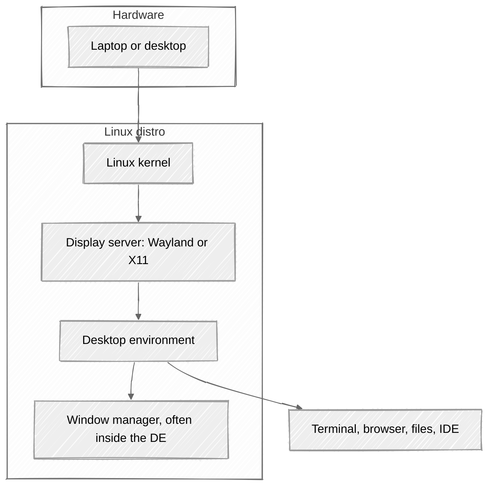

# 3. Choosing a Linux distribution

[← How Linux is put together](02-linux-design.md) · [Home](../README.md) · [Running Linux: VMs and containers →](04-running-linux.md)

A distribution turns the Linux kernel and a pile of open-source software into something you can actually boot, install, and keep patched. Picking a distro means picking its packages, update rhythm, and defaults. For this tutorial, start with **Linux Mint Cinnamon** — unless your professor already picked one for you.

## Three distros worth knowing

You only need to *install* one. You should *recognize* these three, because they show up in class, internships, and "please help my laptop" group chats.

### Linux Mint — the recommended first desktop

[Linux Mint](https://linuxmint.com/) is Ubuntu-based, ships a familiar desktop, and does not try to reinvent the taskbar every six months. **Cinnamon edition** is the one this tutorial installs in [section 5a](05-dev-workstation.md).

- Downloads: [linuxmint.com/download.php](https://linuxmint.com/download.php)
- Installer: [Linux Mint Installation Guide](https://linuxmint-installation-guide.readthedocs.io/en/latest/)
- Editions: **Cinnamon** (default, polished), **MATE** (lighter classic), **XFCE** (lightest official edition)

Mint is the "I want this to feel like a normal computer" option. That is a feature, not a lack of street cred.

### Ubuntu — and the Debian foundation

[Debian](https://www.debian.org/intro/about) is the community-run bedrock behind a huge chunk of Linux. It gives us `.deb` packages, `dpkg`, `apt`, and stable releases that prioritize "boring and tested" over shiny.

[Ubuntu](https://ubuntu.com/) builds on Debian as a [derivative](https://www.debian.org/derivatives/) with Canonical's own repos, release schedule, and polish. Its **LTS** (long-term support) releases are built to outlast several semesters without surprises — see [Ubuntu's release cycle](https://ubuntu.com/about/release-cycle). Default Ubuntu ships **GNOME**; official [Ubuntu flavors](https://ubuntu.com/desktop/flavours) swap in other desktops.

The family tree is **Debian → Ubuntu → Linux Mint**, which is why `apt` commands transfer cleanly across all three. Just don't mix repositories or random `.deb` files across releases — cousins share genes, not kidneys. (Mint also offers [LMDE](https://linuxmint.com/download_lmde.php), based directly on Debian.)

- Desktop: [Install Ubuntu desktop](https://ubuntu.com/tutorials/install-ubuntu-desktop) · [Ubuntu Desktop](https://ubuntu.com/desktop) (GNOME) · [Xubuntu](https://xubuntu.org/) (XFCE) · [Ubuntu Budgie](https://ubuntubudgie.org/) (Budgie)
- Server (no GUI, typical for VMs): [Ubuntu Server](https://ubuntu.com/download/server)

If a cloud assignment, Docker doc, or internship laptop image says Ubuntu, this is why.

### Fedora — upstream-first, with Editions and Spins

[Fedora](https://fedoraproject.org/) is community-driven, sponsored by Red Hat, and lives closer to upstream: newer kernels, recent compilers, Wayland and SELinux enabled by default, and **DNF** for packages. Think of it as where enterprise Linux features try on their outfits before heading to Red Hat Enterprise Linux. Its ~6-month release cadence is great for newer laptops or readers who like fresh toolchains and don't mind upgrading twice a year.

Fedora organizes its desktops into three buckets:

- **Flagship Editions:** [Fedora Workstation](https://fedoraproject.org/workstation/) (clean, unmodified GNOME) and [Fedora KDE Plasma Desktop](https://fedoraproject.org/kde/) (promoted to a full flagship Edition alongside Workstation).
- **[Fedora Spins](https://fedoraproject.org/spins/):** Official, community-maintained builds that keep the same Fedora base and `dnf` repos while swapping the desktop — lightweight/classic ([Xfce](https://fedoraproject.org/spins/xfce/), [Cinnamon](https://fedoraproject.org/spins/cinnamon/), [MATE](https://fedoraproject.org/spins/mate/), [LXQt](https://fedoraproject.org/spins/lxqt/)), modern ([Budgie](https://fedoraproject.org/spins/budgie/), [COSMIC](https://fedoraproject.org/spins/cosmic/)), or keyboard-first tiling WMs ([Sway](https://fedoraproject.org/spins/sway/), [i3](https://fedoraproject.org/spins/i3/)).
- **[Fedora Atomic Desktops](https://fedoraproject.org/atomic-desktops/):** Immutable, image-based variants (like Silverblue for GNOME and Kinoite for KDE) for folks who prefer clean OS rollbacks over hand-editing `/usr`.

Install guide: [Fedora getting started](https://docs.fedoraproject.org/en-US/fedora/latest/getting-started/). This tutorial walks through Mint, so swap `apt` for `dnf` using the Fedora notes at the end of each step.

### Quick comparison

| | **Linux Mint** | **Ubuntu** | **Fedora** |
| --- | --- | --- | --- |
| Family | Ubuntu / Debian | Debian | Red Hat |
| Packages | `apt` | `apt` | `dnf` |
| Default desktop | Cinnamon | GNOME | GNOME (Workstation) or KDE Plasma; plus [Spins](https://fedoraproject.org/spins/) |
| Release feel | Stable, conservative | LTS + interim | Fresh, ~6 month cadence |
| Best first use | Daily driver, older laptops | Class / cloud familiarity | Upstream toolchains & newer hardware |
| Official start | [Download Mint](https://linuxmint.com/download.php) | [Install Ubuntu](https://ubuntu.com/tutorials/install-ubuntu-desktop) | [Fedora Workstation](https://fedoraproject.org/workstation/download) · [Spins](https://fedoraproject.org/spins/) |

Curious what else is out there? [DistroWatch](https://distrowatch.com/) tracks releases and links to project homepages (its ranking measures clicks on that site, not real-world market share — treat it like a menu, not a leaderboard). Debian, Arch, openSUSE, and NixOS are all fun rabbits to chase *after* your assignments compile.

## Desktop flavors: XFCE, GNOME, Budgie (and Cinnamon)

The **desktop environment (DE)** is the GUI: panel, app menu, window decorations, settings. Same distro, different DE, wildly different vibe. Think "same kitchen, different cabinets."

### Cinnamon (this tutorial's default)

[Cinnamon](https://github.com/linuxmint/cinnamon) is Mint's flagship: start menu, system tray, workspaces, a layout Windows/macOS refugees recognize in under a minute. That is why [section 5a](05-dev-workstation.md) uses **Linux Mint Cinnamon edition**.

You can install other DEs later with the package manager. Do not do that on day one. Get one desktop working, then customize.

### GNOME

[GNOME](https://www.gnome.org/) is the default on Ubuntu Desktop and Fedora Workstation. Overview screen, gestures, a "this is a modern desktop" design language. Powerful, polished, and occasionally allergic to minimize buttons you grew up with.

Use GNOME if you want the mainstream Ubuntu/Fedora experience.

### XFCE

[XFCE](https://www.xfce.org/) is light, traditional, and kind to old laptops. Panels, a menu, not much animation. Ships as **Xubuntu**, Mint XFCE, and a [Fedora XFCE Spin](https://fedoraproject.org/spins/xfce/).

Use XFCE if the machine is used, RAM is tight, or you want the UI to stay out of the way. See [Used laptops](07-used-laptops.md).

### Budgie

[Budgie](https://buddiesofbudgie.org/) is a clean, Raven-sidebar desktop. On Ubuntu it is [Ubuntu Budgie](https://ubuntubudgie.org/). Fedora has offered Budgie as a spin / atomic desktop depending on the release — check the current [Fedora spins](https://fedoraproject.org/spins/) page.

Use Budgie if you want something prettier than XFCE and less "GNOME overview" than GNOME.

## Package managers in one paragraph

Software on Linux does not start with a random installer `.exe`. You ask the distro's **package manager** for a package, it pulls a signed build, and updates flow through the same pipe.

- Mint / Ubuntu: **APT** — `apt update`, `apt install`, `apt upgrade`. Full walkthrough in [section 5a](05-dev-workstation.md).
- Fedora: **DNF** — `dnf install`, `dnf upgrade`. Docs: [DNF on Fedora](https://docs.fedoraproject.org/en-US/quick-docs/dnf/).

There are also **Flatpak** (Mint loves this), **Snap** (Ubuntu loves this), and language-level tools (`uv`, `cargo`, `npm`). Distro packages first; random scripts from blogs later, and only after you read them.

## Bottom line: pick one and stop shopping

Default pick: **[Linux Mint Cinnamon](https://linuxmint.com/download.php)**. Reach for Mint **XFCE** / [Xubuntu](https://xubuntu.org/) on an ancient laptop, [Ubuntu](https://ubuntu.com/desktop) if a course demands it, or [Fedora](https://fedoraproject.org/) (Workstation, KDE, or a [Spin](https://fedoraproject.org/spins/)) if you want newer packages. An installed OS teaches more than a spreadsheet of distro logos.

## Industry context: Distributions made by cloud providers

When you enter industry or launch cloud VMs, you will notice major cloud providers maintain their own Linux distributions. These focus strictly on server and container workloads; **they deliberately omit the desktop environment** you want on a student workstation.

| Provider | Distribution | What it is for |
| --- | --- | --- |
| **AWS** | [Amazon Linux](https://docs.aws.amazon.com/linux/al2023/ug/what-is-amazon-linux.html) | AWS-maintained Linux for applications on EC2; Amazon Linux 2023 uses RPM packages and DNF. AWS also makes [Bottlerocket](https://bottlerocket.dev/), a minimal OS designed to host containers. |
| **Microsoft Azure** | [Azure Linux](https://azure.microsoft.com/en-us/products/azure-linux/) | Microsoft's Linux distribution for cloud workloads (formerly CBL-Mariner). The [Azure Linux Container Host](https://learn.microsoft.com/en-us/azure/azure-linux/azure-linux-aks-overview) provides an OS for Kubernetes (AKS) nodes. |
| **Google Cloud (GCP)** | [Container-Optimized OS](https://docs.cloud.google.com/container-optimized-os/docs) | Google's minimal, Chromium OS-based Linux image designed to run containers on Compute Engine and GKE nodes with a locked-down, read-only root filesystem. |

You do not install these on your laptop. But when your future employer asks you to deploy to Amazon Linux, you can smile knowingly: under the branding, it's still Linux with familiar POSIX tools and DNF packages.

## Curiosity for later: Omarchy

[Omarchy](https://omarchy.org/) is an opinionated, Arch-based Linux distribution that assembles a complete developer desktop around the [Hyprland](https://hypr.land/) tiling window manager. “Omakase” means accepting the chef's pre-selected tools, keybindings, and aesthetic. The current ISO line is **Quattro** (Omarchy 4).

It looks gorgeous in r/unixporn screenshots, but a tiling window manager is a different navigation paradigm than Mint's menu and mouse. Start the semester with Mint ([chapter 5a](05-dev-workstation.md)). When you want the keyboard-first path, [chapter 5b](05b-omarchy.md) is the workstation overlay; the [Omarchy Manual](https://omarchy.org/manual/) is the deep dive.

---

**Next:** [Running Linux: virtual machines and containers →](04-running-linux.md)
