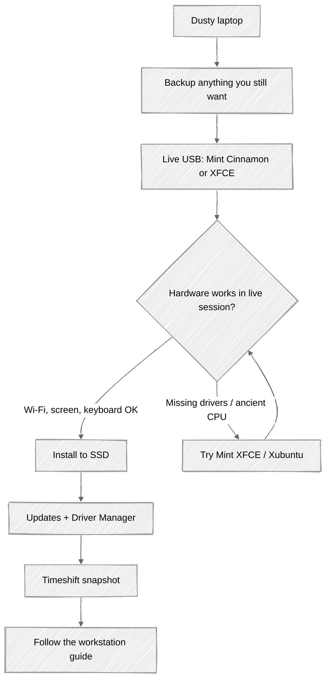

# 7. Used laptops and Linux resurrection

[← Languages and toolchains](06-languages.md) · [Home](../README.md)

Linux is the best reason to buy last year's laptop and the best way to make a 2015 "paperweight" useful again. You do not need a glowing RGB spaceship to compile homework. You need RAM, an SSD, and a kernel that knows the Wi-Fi chip.

> **Shopping for hardware?** This is the physical starting point for **Track B** described on the [Home](../README.md) page. Once you have working metal in your hands and a live USB booted, you'll roll straight into [choosing your edition](03-linux-distributions.md) and [workstation setup](05-dev-workstation.md).

This section is shopping advice plus revival advice. Pair it with [Linux Mint Cinnamon](05-dev-workstation.md) on decent hardware, or Mint **XFCE** / [Xubuntu](https://xubuntu.org/) if the machine is tired.

## Why used + Linux is a CS student cheat code

- New laptops charge you for a sticker and a webcam that still looks like 2012.
- Business-class machines from 3–8 years ago have better keyboards, better repair docs, and more RAM slots than a lot of new "thin" consumer laptops.
- Windows 10-era hardware is often *faster* after you remove the OEM antivirus suite and install Linux.
- If you brick the OS, you reinstall. The metal is still yours.

Environmental angle, said once: extending a laptop's life is the greenest upgrade. Then we go back to RAM.

Two things happened at once, and they are why the used market is full right now. Windows 10 stopped receiving security fixes in October 2025, and Windows 11 wants a TPM 2.0 chip plus an 8th-generation Intel or Ryzen 2000 CPU. Plenty of 2017–2019 laptops have neither. Machines that browse, compile, and Zoom perfectly well are being retired because Microsoft changed the guest list. That is your discount. Check the TPM story before you buy — not because you need Windows, but because everyone selling is pricing against it.

**Last checked:** November 2026. Used prices and Windows requirements move; the hardware advice does not.

## What actually matters (in order)

| Priority | Target for coursework | Why |
| --- | --- | --- |
| **RAM** | 16 GB if you can; **8 GB minimum** | Browsers eat RAM. IDEs eat RAM. Chromium is a pack animal |
| **Storage** | **NVMe or SATA SSD**, 256 GB+ | A spinning HDD makes Linux feel broken when it is merely old |
| **CPU** | Any 4+ core Intel 8th gen / Ryzen 2000 or newer is plenty | You are compiling CS homework, not training a frontier model |
| **Screen** | 1080p, working hinge | 1366×768 is survivable; your eyes will invoice you |
| **Ports** | USB-A, HDMI or USB-C with video | Dongle tax is real |
| **Battery** | 3+ hours after a wear cycle | Replaceable batteries are a gift. Budget for a new cell |
| **Wi-Fi / Bluetooth** | Intel cards preferred | See "chips that cause grief" below |
| **Firmware** | UEFI, unlockable boot menu | You must be able to boot a USB stick |

GPU is almost irrelevant unless you are doing CUDA coursework. Integrated graphics are fine. NVIDIA on Linux works *better than the memes*, and still worse than "I just wanted Wi-Fi."

## Machines that are boring in the correct way

Look for **business lines**, not last year's gaming slab with a melted keyboard:

- **Lenovo ThinkPad** T, X, and P series (T480, T490, T14, X1 Carbon gens that are a few years old). Keyboards, TrackPoints, parts, and Linux reports in abundance.
- **Dell Latitude** and **HP EliteBook** — similar story. Check the specific Wi-Fi card.
- **Framework** (used) if you want repairability as a product feature: [frame.work](https://frame.work/)
- **Desktop mini PCs** (used ThinkCentre, OptiPlex) if you sit at a desk anyway. Cheap RAM upgrades, loud-but-honest fans.

Skip, or research hard:

- **Macs with Apple silicon** — for a hardware install, research support for the exact model through [Asahi Linux](https://asahilinux.org/). To learn Linux on a Mac you already own, an ARM64 VM is another route; see [chapter 4](04-running-linux.md#other-vm-tools-and-wsl).
- **Windows S-mode / locked firmware** school laptops — you may not own the bootloader.
- **No-name specials** with 4 GB soldered RAM and 32 GB eMMC. Linux will install. You will hate it.
- **Very new ultra-light consumer laptops** with Wi-Fi 6E/7 chips that landed last month. Wait for a kernel, or buy Intel Wi-Fi.

Community reports: [Linux Hardware](https://linux-hardware.org/), DistroWatch comments, and `/r/linuxhardware` are more useful than the seller's "runs great!!!"

## Chips that cause grief

| Component | Usually fine | Research before buying |
| --- | --- | --- |
| Wi-Fi | Intel AX/AC cards | Broadcom (common on some Macs and cheap PCs), some MediaTek |
| GPU | Intel, AMD | NVIDIA: installable, extra step ([Mint Driver Manager](https://linuxmint-installation-guide.readthedocs.io/en/latest/)) |
| BIOS | ThinkPad/Latitude firmware | BitLocker leftovers, custom "security" boot, no USB boot |
| Storage | NVMe/SATA SSD | 32 GB eMMC soldered, Intel RST "RAID" mode in firmware |

If the listing photos show a Broadcom Wi-Fi card and you cannot change it, have an ethernet dongle ready for the install.

## Buying checklist (ten minutes in a café)

Before money changes hands, do two quick passes:

1. **Physical & ownership sanity check:** Inspect screen, keyboard, speakers, and ports; unplug the charger (a battery that dies in 20 minutes is a discount negotiation, not a feature); check `free -h` and `lsblk` for real RAM/SSD specs; open firmware (F1/F2/F12) to confirm you can boot USB and toggle Secure Boot ([Mint boot notes](https://linuxmint-installation-guide.readthedocs.io/en/latest/boot.html)); and walk away if it is **stolen**, **BIOS-locked**, or **MDM/school-enrolled**.
2. **Boot a [Linux Mint live USB](https://linuxmint-installation-guide.readthedocs.io/en/latest/burn.html)** and run this six-item live-session check:

| Check | What to do | What good looks like |
| --- | --- | --- |
| **Wi-Fi** | Connect to the café network | Joins without a driver hunt; survives a sleep |
| **Suspend** | Close the lid, wait ten seconds, open it | Wakes to the lock screen, not a black rectangle |
| **Audio** | Play a video | Sound from speakers and headphone jack |
| **Webcam** | Open the camera app or a browser test | You, in focus, not a green rectangle |
| **Brightness** | Press the brightness keys | The screen dims; the keys are not decorative |
| **Touchpad** | Two-finger scroll, tap-to-click | The pointer obeys, including after suspend |

If Wi-Fi fails on an Intel card, check `rfkill list` and `dmesg | grep -i firmware`. Pay a little more for a machine with an SSD already inside — swapping a 2.5" SATA drive is easy; prying open glued ultrabooks is not.

## Bringing an old laptop back

The ritual is older than some freshmen:



1. **Backup.** Old `Documents/` folders have a way of containing the only copy of something. Copy off the disk first.
2. **Swap HDD → SSD** if the machine still has a spinning disk. This single change does more than a new distro. Clone or just reinstall; reinstall is cleaner.
3. **Max the RAM** if there are empty slots. 2×8 GB is the student sweet spot.
4. **Install Linux Mint.** Cinnamon if the CPU is from the last decade; **XFCE edition** if it wheezes. Guide: [Mint installation](https://linuxmint-installation-guide.readthedocs.io/en/latest/).
5. **First boot:** Update Manager, Driver Manager, then [section 5](05-dev-workstation.md) and [section 6](06-languages.md).
6. **Power:** install [TLP](https://linrunner.de/tlp/) (`sudo apt install tlp`) on older ThinkPads if you care about battery. Mint often feels fine without it; measure before you tune.

If the live USB cannot see the disk, look in firmware for **SATA mode**. RAID/RST often needs to be AHCI for a normal install. Changing that on a disk that still has Windows will make Windows unhappy — another reason to backup and commit.

### How old is too old?

- **64-bit CPU required** for current Mint/Ubuntu/Fedora (`lscpu` checks). 32-bit-only machines are museum pieces.
- **4 GB RAM** is the bare floor for a browser + terminal (**2 GB** works only as a terminal box — modern web pages will make it reconsider its life choices). Aim for the 8–16 GB targets in the priority table above.
- Pre-UEFI BIOS boxes can still run Linux dedicated, just don't try to dual-boot them with modern Windows.

When the laptop is truly too slow: retire it gracefully as a **home SSH box**, Git remote, or PostgreSQL toy server on a shelf.

## When the hardware fights back

Five problems account for most "Linux does not work on my laptop" evenings. None of them require a reinstall.

### Wi-Fi

```bash
lspci -nn | grep -i network        # which chip is it?
rfkill list                        # is it blocked in software?
sudo dmesg | grep -i -E 'firmware|iwlwifi|rtw|brcm'
```

Intel cards usually just work. Broadcom is the usual culprit; on Mint, open **Driver Manager** first and let it offer the proprietary driver. The manual version is `sudo apt install bcmwl-kernel-source`, then reboot. If `rfkill` says `Soft blocked: yes`, run `sudo rfkill unblock wifi` before you debug the driver.

### NVIDIA

Open **Driver Manager** and pick the recommended proprietary driver. On Ubuntu, the terminal equivalent is:

```bash
ubuntu-drivers devices
sudo ubuntu-drivers autoinstall
nvidia-smi          # after reboot; if this prints a table, the driver is alive
```

If the screen goes black before the desktop, boot with `nomodeset` added to the kernel line in GRUB, get in, and install the driver from there. The open-source `nouveau` driver is fine for a desktop and poor for CUDA.

### Audio

```bash
sudo apt install pavucontrol
pavucontrol                         # check the Output tab and the profile
alsamixer                           # unmute anything with MM above it
systemctl --user status pipewire wireplumber
```

Nine times out of ten the device is muted, on the wrong [PipeWire](https://pipewire.org/) profile, or sending audio to an HDMI monitor you unplugged last week. `pavucontrol` shows which.

### Bluetooth

```bash
systemctl status bluetooth
rfkill list bluetooth
bluetoothctl
```

Inside `bluetoothctl`: `power on`, `agent on`, `scan on`, then `pair <MAC>` and `trust <MAC>`. If the adapter is missing entirely, it is the same firmware story as Wi-Fi.

### Suspend and resume

```bash
systemctl suspend
journalctl -b -1 | tail -50         # the boot that failed to wake
```

Wake failures are firmware-shaped. Update the BIOS via [fwupd / LVFS](https://fwupd.org/) (`sudo apt install fwupd && fwupdmgr get-updates`), try a newer kernel, and check the model's page on [Linux Hardware](https://linux-hardware.org/). If suspend is hopeless, disabling it is a valid answer for a desk-bound machine.

## Suggested cart for a used workstation

Budget-ish, not a shopping affiliate list:

- Used ThinkPad T-series or Dell Latitude, 16 GB RAM, 256+ GB SSD
- USB installer stick (3.0 if the ports are 3.0)
- Replacement charger from a reputable vendor (cheap no-name bricks start fires)
- Optional: USB ethernet dongle for the first afternoon

Then install Cinnamon or XFCE and go back to [section 5](05-dev-workstation.md) and [section 6](06-languages.md). The hardware is the boring part. The boring part is the point.

## Further reading

- [Linux Mint installation guide](https://linuxmint-installation-guide.readthedocs.io/en/latest/)
- [Xubuntu](https://xubuntu.org/) and [XFCE](https://www.xfce.org/) for light desktops
- [Fedora Spins](https://fedoraproject.org/spins/) if you prefer Fedora on the same hardware
- [learning-shell](https://github.com/amitsk/learning-shell) once the keyboard works

---

[← Languages and toolchains](06-languages.md) · [Back to the start](../README.md)
